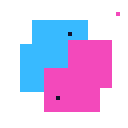
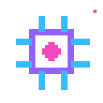
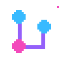

<p align="center"></p>

<p align="center"></p>

<h1 align="center">S2800-0.exe</h1>
<p align="center"><code>DEVELOPER // EXPLORER // TIME TRAVELLER</code></p>

<p align="center"></p>

### `~ $ whoami`

```text
> SYSTEM ONLINE
> I'm S2800-0.
> Building software, experimenting with AI,
> and turning ideas into working systems.
```

### `~/projects`


```text
├── incident-commander/  AI SRE agent with safety guardrails
└── icvsp/               Computer vision road hazard detection
```

### `~/tech-stack`

<p>
   Python &nbsp;
   AI &nbsp;
   Automation &nbsp;
   Computer Vision &nbsp;
   Git &nbsp;
   Linux
</p>

### `~/contact`

<p align="center">
  <a href="https://github.com/S2800-0"></a>
  &nbsp;&nbsp;
  <a href="mailto:shahesta0028@gmail.com"></a>
  &nbsp;&nbsp;
  <a href="https://www.linkedin.com/in/shahesta-salama-396566320/"></a>
</p>

<p align="center"><sub>✦ TARDIS SYSTEMS ACTIVE ✦<br/>Time is relative. Deadlines aren't.</sub></p>

<p align="center"></p>
