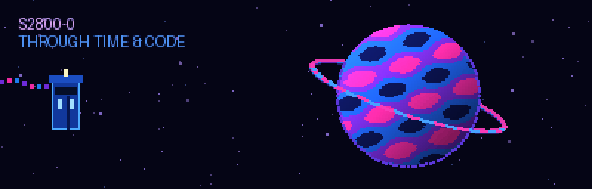
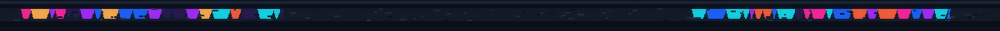
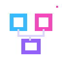
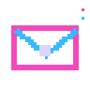
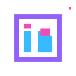
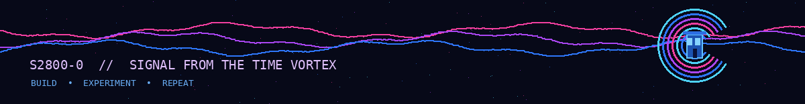

<h1 align="center">S2800-0  // SYSTEM ONLINE</h1>

<code>AI • DATA ENGINEERING • CLOUD • SOFTWARE</code>

Building intelligent systems, data pipelines, and useful software. Engineering in this timeline. Exploring the next.

<h2 align="center">✦ Selected Projects ✦</h2>

 
An SRE agent that decides when <i>not</i> to act · 1st Place, ITIDA DevOps Day 2026
  
 
Road-hazard warnings on the edge with a trust engine

<a href="https://github.com/S2800-0?tab=repositories"> Explore my repositories ↗</a>

<h2 align="center">✦ Tech Stack ✦</h2>

What I build with day to day.

<b>Languages</b>

&nbsp;Python &nbsp;&nbsp; &nbsp;C++ &nbsp;&nbsp; &nbsp;TypeScript

<b>AI / ML</b>

&nbsp;PyTorch &nbsp;&nbsp; &nbsp;Scikit-learn &nbsp;&nbsp; &nbsp;YOLO &nbsp;&nbsp; &nbsp;OpenCV

<b>Data</b>

&nbsp;Spark &nbsp;&nbsp; &nbsp;Kafka &nbsp;&nbsp; &nbsp;Airflow &nbsp;&nbsp; &nbsp;PostgreSQL &nbsp;&nbsp; &nbsp;Pandas

<b>Cloud &amp; DevOps</b>

&nbsp;AWS &nbsp;&nbsp; &nbsp;Docker &nbsp;&nbsp; &nbsp;GitHub Actions &nbsp;&nbsp; &nbsp;Prometheus 
&nbsp;Grafana &nbsp;&nbsp; &nbsp;Linux &nbsp;&nbsp; &nbsp;Git

<b>Back-end &amp; Front-end</b>

&nbsp;FastAPI &nbsp;&nbsp; &nbsp;React &nbsp;&nbsp; &nbsp;Streamlit

<h2 align="center">Incoming transmission 📡</h2>

Have an idea worth exploring? Send a signal — I’m always interested in ambitious builds, open-source projects, and interesting engineering problems.

&nbsp;&nbsp;&nbsp;
&nbsp;&nbsp;&nbsp;

GitHub · Email · LinkedIn

