

<h1 align="center">S2800-0  // SYSTEM ONLINE</h1>

<code>AI • DATA ENGINEERING • CLOUD • SOFTWARE</code>

Building intelligent systems, data pipelines, and useful software. Engineering in this timeline. Exploring the next.

<h2 align="center">✦ Selected Projects ✦</h2>

<a href="https://github.com/S2800-0?tab=repositories"> Explore my repositories ↗</a>

<table align="center">
<tr><td><a href="https://github.com/incident-commander-lab/incident-commander"><b>Incident Commander</b></a></td><td>An SRE agent that decides when <i>not</i> to act: Bayesian probe selection, a policy gate outside the agent, reversible actions only. 1st Place, ITIDA DevOps Day 2026 · <a href="https://incident-commander-talk.vercel.app">watch the talk</a></td></tr>
<tr><td><a href="https://github.com/S2800-0/icvsp-prototype"><b>ICVSP</b></a></td><td>Graduation project, mentored by Valeo engineers: road-hazard detection on the edge with a trust engine that resists fake reports.</td></tr>
<tr><td><a href="https://github.com/S2800-0/kafka-spark-hive-ecommerce-pipeline"><b>Real-time order pipeline</b></a></td><td>Kafka → Spark Structured Streaming → HDFS → Hive, replacing a 12-hour nightly batch.</td></tr>
</table>

<h2 align="center">✦ Technologies ✦</h2>

My toolkit across engineering, AI, infrastructure, and the web.

<h3 align="center">Languages</h3>
<table align="center"><tr>
<td align="center" width="108"> Python</td>
<td align="center" width="108"> C++</td>
<td align="center" width="108">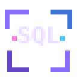 SQL</td>
<td align="center" width="108"> TypeScript</td>
<td align="center" width="108"> JavaScript</td>
<td align="center" width="108"> Bash</td>
</tr></table>

<h3 align="center">AI / ML</h3>
<table align="center"><tr>
<td align="center" width="108"> PyTorch</td>
<td align="center" width="108"> Scikit-learn</td>
<td align="center" width="108"> TensorFlow / Keras</td>
<td align="center" width="108">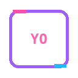 YOLO (Ultralytics)</td>
<td align="center" width="108"> SegFormer</td>
<td align="center" width="108"> OpenCV</td>
<td align="center" width="108">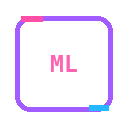 MLflow</td>
</tr><tr>
<td align="center" width="108">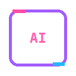 LLM Agents (OpenAI / Anthropic)</td>
</tr></table>

<h3 align="center">Data Engineering</h3>
<table align="center"><tr>
<td align="center" width="108"> Apache Spark</td>
<td align="center" width="108"> Kafka</td>
<td align="center" width="108">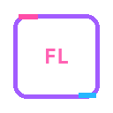 Flink</td>
<td align="center" width="108"> NiFi</td>
<td align="center" width="108">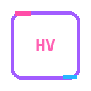 Hive</td>
<td align="center" width="108"> HDFS / Hadoop</td>
<td align="center" width="108">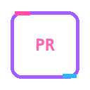 Presto</td>
</tr><tr>
<td align="center" width="108"> Airflow</td>
<td align="center" width="108">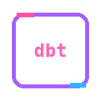 dbt</td>
<td align="center" width="108">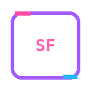 Snowflake</td>
<td align="center" width="108">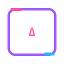 Delta Lake</td>
<td align="center" width="108"> PostgreSQL</td>
<td align="center" width="108"> Pandas</td>
<td align="center" width="108"> NumPy</td>
</tr></table>

<h3 align="center">Cloud &amp; DevOps</h3>
<table align="center"><tr>
<td align="center" width="108"> AWS (Lambda / Glue / S3 / Athena)</td>
<td align="center" width="108"> Microsoft Fabric</td>
<td align="center" width="108"> Docker</td>
<td align="center" width="108"> Kubernetes</td>
<td align="center" width="108"> GitHub Actions</td>
<td align="center" width="108"> Linux</td>
<td align="center" width="108"> Git</td>
</tr></table>

<h3 align="center">Reliability &amp; Observability</h3>
<table align="center"><tr>
<td align="center" width="108"> Prometheus</td>
<td align="center" width="108"> Grafana</td>
<td align="center" width="108"> OpenTelemetry</td>
<td align="center" width="108">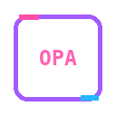 Open Policy Agent</td>
</tr></table>

<h3 align="center">Back-end &amp; Front-end</h3>
<table align="center"><tr>
<td align="center" width="108"> FastAPI</td>
<td align="center" width="108"> Flask</td>
<td align="center" width="108"> NestJS</td>
<td align="center" width="108">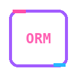 TypeORM</td>
<td align="center" width="108"> React</td>
<td align="center" width="108"> Streamlit</td>
<td align="center" width="108"> Dash / Plotly</td>
</tr><tr>
<td align="center" width="108">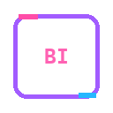 Power BI</td>
</tr></table>

<h2 align="center">Incoming transmission 📡</h2>

Have an idea worth exploring? Send a signal — I’m always interested in ambitious builds, open-source projects, and interesting engineering problems.

&nbsp;&nbsp;&nbsp;
&nbsp;&nbsp;&nbsp;

GitHub · Email · LinkedIn

